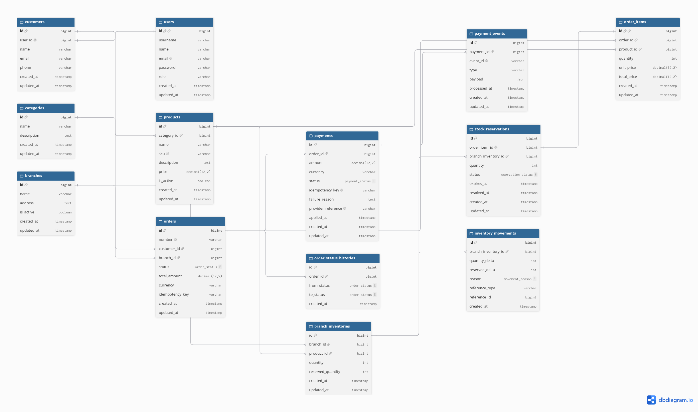
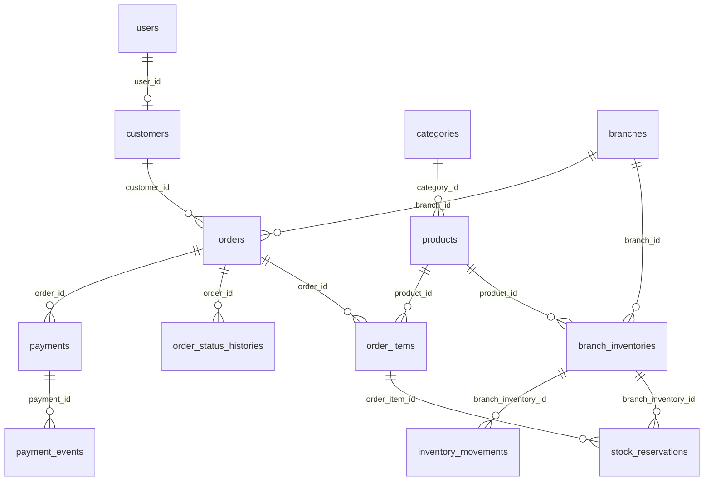

# Laravel Advanced Backend (E-Ramo)

REST API for multi-branch retail operations: customer authentication, product catalog, branch-level stock, order placement with atomic stock reservations, order lifecycle management, simulated payments, and inventory audit trails.

The API is versioned under `/api/v1`. A minimal web route serves the default Laravel welcome page at `/`. A health check is available at `/up` (not under `/api`).

## Implemented features

- **API access control**: All `/api/*` requests are validated by `EnsureValidApiKey` using the `X-APP-ACCESS-KEY` header (see [Authentication and API security](#authentication-and-api-security)).
- **Authentication (Laravel Sanctum)**: Register, login, profile, logout, logout-all, and password change for users with roles `customer` or `admin`. Registration creates a linked `customers` profile.
- **Login rate limiting**: `POST /api/v1/auth/login` is limited to 5 attempts per minute per username and IP (`throttle:login`).
- **Catalog**: Paginated list of active products; per-branch product availability with reserved quantity deducted from sellable stock.
- **Orders**: Create orders with server-side pricing, stock reservation, optional `Idempotency-Key` header, lifecycle transitions (`confirm`, `process`, `complete`), and cancellation with inventory movements and status history.
- **Payments**: Simulated payment attempts and idempotent payment callback events; successful payments can confirm pending orders. Background reconciliation via scheduled command and queue job.
- **Stock reservations**: TTL-based expiration (`config/inventory.php`), `ExpireStockReservation` queue job, and `reservations:expire` scheduled command.
- **Inventory movements**: Paginated audit log (admin users only).
- **Database seeding**: Categories, products, branches, branch inventory, sample inventory movements, users, and customers.
- **Automated tests**: Feature tests cover auth, API key middleware, products, orders, payments, reservations, queue reliability, concurrency (MySQL), and inventory movements.
- **Concurrency design**: See [CONCURRENCY.md](CONCURRENCY.md) for transaction boundaries, row locks, overselling prevention, and queue idempotency.

## Technologies and requirements

| Requirement | Version / notes |
|-------------|-----------------|
| PHP | `^8.2` (`composer.json`) |
| Laravel | 12.x |
| Laravel Sanctum | 4.x |
| Database | MySQL (default in `.env.example`: database `e-ramo`) |
| Queue | `database` driver (jobs table migration included) |
| Cache / session | `database` (migrations included) |
| Node.js | For Vite front-end assets (`package.json`) |

**PHP extensions**: Standard Laravel requirements (e.g. `pdo_mysql`, `mbstring`, `openssl`, `tokenizer`, `json`, `ctype`, `fileinfo`).

## Installation and setup

### 1. Clone and install dependencies

```bash
composer install
```

### 2. Environment file

```bash
cp .env.example .env
php artisan key:generate
```

Configure at minimum:

| Variable | Purpose |
|----------|---------|
| `APP_URL` | Application URL (e.g. `http://localhost:8000`) |
| `DB_CONNECTION`, `DB_HOST`, `DB_PORT`, `DB_DATABASE`, `DB_USERNAME`, `DB_PASSWORD` | MySQL connection (example database name: `e-ramo`) |
| `APP_ACCESS_KEY` | Shared secret sent by clients as `X-APP-ACCESS-KEY` (example in `.env.example`: `123456789`) |
| `APP_API_RATE_LIMIT` | Defined in `config/api.php` (default `60`); **not wired to global API middleware in the current codebase** |
| `QUEUE_CONNECTION` | Use `database` for background jobs (matches `.env.example`) |

Optional (used in tests and `config/inventory.php`, not listed in `.env.example`):

| Variable | Default | Purpose |
|----------|---------|---------|
| `RESERVATION_TTL_MINUTES` | `15` | Minutes before an active stock reservation expires |

### 3. Create databases

Create the application database and a separate database for PHPUnit (as defined in `phpunit.xml`):

```bash
# Example MySQL — adjust credentials to match your .env
mysql -u root -e "CREATE DATABASE IF NOT EXISTS \`e-ramo\` CHARACTER SET utf8mb4 COLLATE utf8mb4_unicode_ci;"
mysql -u root -e "CREATE DATABASE IF NOT EXISTS \`e_ramo_test\` CHARACTER SET utf8mb4 COLLATE utf8mb4_unicode_ci;"
```

### 4. Migrations and seeders

```bash
php artisan migrate
php artisan db:seed
```

`DatabaseSeeder` runs: `CategorySeeder`, `ProductSeeder`, `BranchSeeder`, `BranchInventorySeeder`, `InventoryMovementSeeder`, `UserSeeder`, `CustomerSeeder`.

**Seeded users** (`UserSeeder`):

| Username | Password | Role |
|----------|----------|------|
| `admin` | `Password123!` | Admin |
| `customer1` | `Password123!` | Customer (with customer profile) |
| `customer2` | `Password123!` | Customer (with customer profile) |

### 5. Front-end assets (optional for API-only use)

```bash
npm run build
```

## Running the application

| Task | Command |
|------|---------|
| HTTP server | `php artisan serve` |
| Dev stack (server, queue listener, logs, Vite) | `composer run dev` |
| Queue worker | `php artisan queue:work` (or `queue:listen`) |
| Scheduler | `php artisan schedule:work` — runs `reservations:expire` and `payments:reconcile` every minute (`routes/console.php`) |
| One-off maintenance | `php artisan reservations:expire` · `php artisan payments:reconcile` |

Verify routes:

```bash
php artisan route:list --path=api
```

## Authentication and API security

### API application key (`X-APP-ACCESS-KEY`)

This project does **not** use an `X-ACCESS-TOKEN` header. Client access to the API is gated by **`X-APP-ACCESS-KEY`**.

- **Middleware**: `App\Http\Middleware\EnsureValidApiKey` (appended globally in `bootstrap/app.php`).
- **Scope**: Requests matching `api` or `api/*`.
- **Exemptions**: `OPTIONS` requests and signed URLs (`$request->hasValidSignature()`).
- **Configuration**: Set `APP_ACCESS_KEY` in `.env`. The server reads it via `config('api.key')` (`config/api.php`).
- **Validation**: Constant-time comparison with `hash_equals`.
- **Responses**: Missing key → 401; invalid key → 401; empty server key → 500.

Every API example below must include this header.

### Laravel Sanctum (Bearer token)

Protected routes use the `auth:sanctum` middleware (`routes/api/v1.php`).

- **Token issuance**: `POST /api/v1/auth/register` and `POST /api/v1/auth/login` return a Sanctum plain-text token in the JSON payload (via `AuthResponseResource`).
- **Authenticated requests**: Send `Authorization: Bearer {token}` together with `X-APP-ACCESS-KEY`.
- **Guards**: Sanctum is configured in `config/sanctum.php` (token-based API usage; stateful SPA domains are listed but not required for Bearer tokens).

There is **no** `LANG` header middleware or `SetApiLocale` in this codebase. API messages use Laravel’s default locale (`APP_LOCALE` in `.env.example` is `en`).

### Request examples

**Login (API key only, no Bearer token):**

```bash
curl -s -X POST "${APP_URL:-http://127.0.0.1:8000}/api/v1/auth/login" \
  -H "X-APP-ACCESS-KEY: ${APP_ACCESS_KEY:-123456789}" \
  -H "Accept: application/json" \
  -H "Content-Type: application/json" \
  -d '{"username":"customer1","password":"Password123!"}'
```

**Authenticated catalog request:**

```bash
curl -s "${APP_URL:-http://127.0.0.1:8000}/api/v1/products?page=1&per_page=20" \
  -H "X-APP-ACCESS-KEY: ${APP_ACCESS_KEY:-123456789}" \
  -H "Accept: application/json" \
  -H "Authorization: Bearer YOUR_SANCTUM_TOKEN"
```

**Create order (customer with profile; optional idempotency):**

```bash
curl -s -X POST "${APP_URL:-http://127.0.0.1:8000}/api/v1/orders" \
  -H "X-APP-ACCESS-KEY: ${APP_ACCESS_KEY:-123456789}" \
  -H "Accept: application/json" \
  -H "Content-Type: application/json" \
  -H "Authorization: Bearer YOUR_SANCTUM_TOKEN" \
  -H "Idempotency-Key: unique-key-001" \
  -d '{"branch_id":1,"items":[{"product_id":1,"quantity":2}]}'
```

JSON responses follow the unified shape from `App\Traits\ApiResponses` (`status`, `success`, `message`, `data`, `timestamp`, and pagination metadata where applicable).

## API endpoints

Base path: **`/api/v1`**.  
Unless noted, all routes require **`X-APP-ACCESS-KEY`**.

| Method | Path | Sanctum | Description |
|--------|------|---------|-------------|
| POST | `/auth/register` | No | Register customer user; returns user + token. Body: `username`, `name`, `password`, `password_confirmation`. |
| POST | `/auth/login` | No | Login; 5/min rate limit. Body: `username`, `password`. |
| GET | `/auth/profile` | Yes | Current user and customer profile. |
| POST | `/auth/logout` | Yes | Revoke current access token. |
| POST | `/auth/logout-all` | Yes | Revoke all tokens for the user. |
| PUT | `/auth/password` | Yes | Change password; revokes other tokens. Body: `current_password`, `password`, `password_confirmation`. |
| GET | `/products` | Yes | Paginated active products with category. Query: `page`, `per_page` (via `App\Support\Pagination`). |
| GET | `/branches/{branch}/products` | Yes | Branch availability for active products; `{branch}` is numeric branch **ID**. |
| POST | `/orders` | Yes | Create order and reserve stock. Customer role requires a customer profile. Optional header `Idempotency-Key`. |
| GET | `/orders/{order}` | Yes | Order detail and status history; `{order}` is numeric order **ID**. Owner customer or admin. |
| POST | `/orders/{order}/confirm` | Yes | Pending → confirmed (requires active reservations). Owner or admin. Optional body `note`. |
| POST | `/orders/{order}/process` | Yes | Confirmed → processing. Owner or admin. Optional `note`. |
| POST | `/orders/{order}/complete` | Yes | Processing → completed. Owner or admin. Optional `note`. |
| POST | `/orders/{order}/cancel` | Yes | Cancel eligible order and release stock. Owner or admin. Optional `note`. |
| POST | `/payments` | Yes | Simulate payment for an order. Body includes `order_id`, `idempotency_key` (or `Idempotency-Key` header), optional `outcome`, `event_id`, `failure_reason`. |
| POST | `/payments/events` | Yes | Idempotent payment callback/event processing. |
| GET | `/inventory-movements` | Yes | Paginated inventory movements; **admin role only** (403 for customers). |

## Database design

Schema is defined in `database/migrations/`. Core domain tables:

| Area | Tables |
|------|--------|
| Auth | `users`, `customers`, `personal_access_tokens` |
| Catalog | `categories`, `products` |
| Inventory | `branches`, `branch_inventories`, `stock_reservations`, `inventory_movements` |
| Orders | `orders`, `order_items`, `order_status_histories` |
| Payments | `payments`, `payment_events` |
| Infrastructure | `jobs`, `cache`, `cache_locks`, `sessions` |

### Entity-relationship diagram (ERD)

<p align="center">
  <a href="ERD-Digrame.png">
    
  </a>
</p>

<p align="center"><em>Click the diagram to open the full-resolution image (<code>ERD-Digrame.png</code> in the repository root).</em></p>

<details>
<summary><strong>Text overview (same relationships as the diagram)</strong></summary>



</details>

## Testing

### Prerequisites

PHPUnit is configured for MySQL database **`e_ramo_test`** (`phpunit.xml`). Ensure MySQL is running and that database exists before running tests.

Tests use `APP_ACCESS_KEY=123456789` and `RESERVATION_TTL_MINUTES=15` from `phpunit.xml`. The queue runs synchronously in tests (`QUEUE_CONNECTION=sync`).

### Commands

```bash
# Project script (clears config cache, then runs PHPUnit)
composer test

# Or directly
php artisan test --compact

# Single file
php artisan test --compact tests/Feature/AuthApiTest.php

# Coverage (requires PCOV or Xdebug)
php artisan test --coverage
```

### Test suite overview

| Test class | Focus |
|------------|--------|
| `ApiKeyMiddlewareTest` | Missing, invalid, and valid `X-APP-ACCESS-KEY` |
| `AuthApiTest` | Register, login, rate limit, profile, logout, password change |
| `ProductAndBranchAvailabilityApiTest` | Product listing, branch stock, pagination, 404/401 |
| `OrderCreationTest` | Order creation, idempotency, stock/validation, pricing integrity |
| `OrderLifecycleAndCancellationTest` | Status transitions, cancellation, concurrency (MySQL) |
| `OrderConcurrencyTest` | Concurrent reservation attempts |
| `PaymentSimulatorTest` | Payments, idempotency, reconciliation command/job |
| `QueueReliabilityTest` | Queue job retry, duplicate execution guards, missing-row handling |
| `StockReservationExpirationTest` | TTL jobs, scheduler command, concurrency |
| `OrderManagementApiTest` | Order HTTP API (show, lifecycle, cancel) |
| `InventoryMovementApiTest` | Admin-only movement listing |
| `ExampleTest` / `Unit/ExampleTest` | Smoke examples |

**Count**: 104 test methods across the suite (excluding vendor).

Automated coverage was **not** executed in environments without a running MySQL `e_ramo_test` database; run `php artisan test --coverage` locally after DB setup for metrics.

## Project structure (high level)

- `app/Http/Controllers/Api/` — API controllers (`Auth`, `V1`)
- `app/Services/` — `AuthService`, `OrderService`, `PaymentService`
- `app/Jobs/` — `ExpireStockReservation`, `ReconcileSucceededPayment`
- `app/Console/Commands/` — Scheduled and concurrency helper commands
- `routes/api.php` — Loads `routes/api/v1.php` under prefix `v1`
- `lang/` — API translation strings

## License

The Laravel framework is open-sourced software licensed under the [MIT license](https://opensource.org/licenses/MIT).
